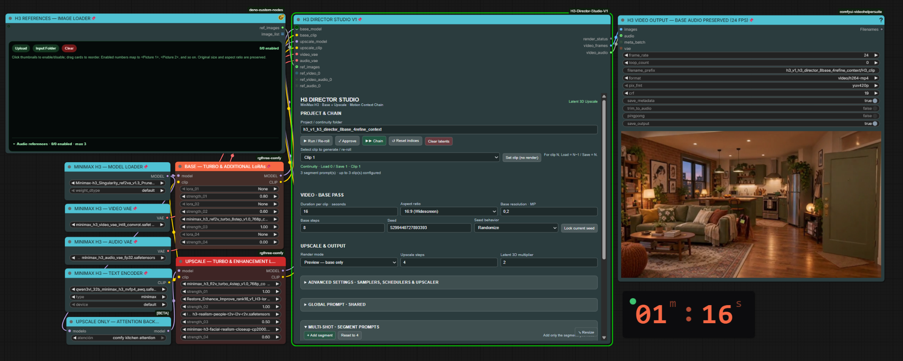

# MiniMax H3 Chain Director V1

**H3 Director Studio V1** is a custom ComfyUI node for controlling MiniMax H3 video generation from a centralized interface. It combines prompt and segment direction, configurable **BASE + UPSCALE** processing, and audiovisual continuity mechanisms. Users can work in **Single** or **Chain** mode without giving up ComfyUI's external node connections.

## Key features

### Integrated video direction
- Centralized video generation control panel.
- Two-stage pipeline: **BASE** generation followed by **UPSCALE**.
- **Single** and **Chain** production modes.
- Inputs for reference images, video, and audio.

### Prompt and segment management
- **General Prompt** for shared instructions.
- Independent prompts for individual video segments.
- Add segments with a dedicated button; edit them in expandable/collapsible panels.
- Select the segment to generate.

### Chain mode and continuity
- Build multi-segment sequences and control sequential execution from the Director interface.
- Save and restore continuity states between segments.
- Integrate **MiniMax H3 Motion Context** to carry forward audiovisual context.
- Trim context automatically to avoid repeated transition frames.

### Generation controls

| Setting | Control |
| --- | --- |
| Video duration | Configure clip duration |
| Aspect ratio | Select the output aspect ratio |
| BASE resolution | Set initial resolution in megapixels |
| Sampling steps | Configure BASE and UPSCALE separately |
| Sampler and scheduler | Select independently for each stage |
| Seed | Fixed or randomized |
| Render mode | **Preview BASE** or **Final** |
| Models and LoRAs | Independent configurations for BASE and UPSCALE |

### Integrated UPSCALE pipeline
- **3D latent upscaling** within the workflow.
- Configurable upscale multiplier.
- A second sampling pass for refinement of the upscaled result.

## Recommended two-stage model and LoRA setup

The workflow exposes **two separate LoRA loaders**, one for each stage. This is intentional: the first loader applies the selected **Turbo LoRA** and optional additional LoRAs during **BASE**, while the second can apply **a different Turbo LoRA** and optional enhancement LoRAs during **UPSCALE**. Different Turbo choices can therefore be tested for initial generation and final visual quality, with independently configured strengths.

### Recommended models — photorealism-oriented configuration

**H3 Director Studio V1 is configured with an emphasis on photorealism, natural textures, realistic motion, and fine visual detail.** The selections below reflect the developer's practical tests and visual preferences, **not mandatory dependencies, a universal quality ranking, or a controlled benchmark**.

**Recommended BASE models:**
- **[Singularity Ref2VA v1.3](https://huggingface.co/WarmBloodAban/Minimax-h3_Singularity)** — a MiniMax H3 model option.
- **[10Eros TURBO-hybrid Beta5](https://huggingface.co/TenStrip/10Eros-Max)** — another MiniMax H3 model option.

**Preferred UPSCALE configuration for realistic-looking results:**
- **[MiniMax H3 FL2V Turbo 4-Step](https://huggingface.co/Comfy-Org/MiniMax-H3/blob/main/loras/minimax_h3_fl2v_turbo_4step_v1.0_768p_comfyui_bf16.safetensors)** — `minimax_h3_fl2v_turbo_4step_v1.0_768p_comfyui_bf16.safetensors`. Preferred in the second sampling stage for the visual realism and quality preferred in this configuration. This file is labeled **FL2V**, not FL2VA; the names should not be treated as interchangeable.
- **H3 LMS latent upscaler** — `h3_upscaler_lms_v0.1`, preferred for fine detail and natural-looking textures. It is a *checkpoint used by a compatible 3D latent-upscaler node*, not an alternative node. See the [LMS model documentation](https://huggingface.co/Alissonerdx/Minimax-H3-ComfyUI/blob/main/README.md).

The two independent LoRA loaders allow different compatible Turbo and enhancement LoRAs to be selected for **BASE** and **UPSCALE**. Check that each model, LoRA, and upscaler is compatible with the chosen stage, node implementation, and settings.

**These choices are recommendations, not restrictions.** Users can select their own compatible checkpoints, LoRAs, upscalers, and processing settings to pursue realistic, cinematic, stylized, or artistic results. Model weights are not included in this repository and retain their original creators' licenses.

**The Director provides the tools. The creative choices belong to the user.**

### Attention acceleration: observed configuration

The example workflow applies the **optional Attention backend only to UPSCALE**.

- **BASE:** without the additional Attention acceleration patch.
- **UPSCALE:** with the additional Attention acceleration patch.

This refers to an **optional acceleration patch**, **not** to disabling the model's internal attention mechanism. Results depend on checkpoint, hardware and settings.

Likewise, using different Turbo LoRAs in the two stages is an available configuration and optional configuration; higher final quality is a goal of the setup, **not a universally validated outcome**. Compare configurations with controlled settings and evaluate results on your own system.

## Flexible external connections

Although the Director offers a centralized interface, its **external ComfyUI node connections remain visible and accessible**. Users can adapt the workflow to their preferred setup, for example by:

- Connecting different model loaders and LoRA configurations.
- Providing alternative reference image, video, or audio sources.
- Integrating additional ComfyUI processing nodes.
- Experimenting with other supported generation arrangements.

The goal is integrated direction **without locking users into one fixed node graph**. Compatibility with every possible external configuration has not been verified.

## Integrated live monitor

The Director's live generation monitor displays step progress and animated previews through **KJNodes Model Preview Override**, listening to the `kj_preview_override` websocket event; it also supports ComfyUI progress events. **ComfyUI-KJNodes is required** for live previews. No separate queue-monitor node is needed for the integrated monitor.

## Repository layout

- `__init__.py`: Python node implementation.
- `web/studio.js`: ComfyUI frontend panel.
- `docs/DEPENDENCIES.md`: dependencies and model setup notes.
- `docs/CREDITS.md`: upstream authors, model acknowledgements and third-party licenses.
- `workflows/`: [sanitized example workflow](workflows/H3_DIRECTOR_STUDIO_V1_PUBLIC.json).
- `assets/`: project screenshots and illustrations.

## Installation

See the [step-by-step installation and validation guide](docs/INSTALLATION.md).

Clone this repository to `ComfyUI/custom_nodes/ComfyUI-H3-Director-Studio-V1`, install the third-party custom nodes documented in `docs/DEPENDENCIES.md`, and restart ComfyUI. Model weights and LoRAs must be downloaded separately from their upstream sources. The [example workflow](workflows/H3_DIRECTOR_STUDIO_V1_PUBLIC.json) is available for import into ComfyUI.

## Credits, licenses and distribution notes

See [dependencies](docs/DEPENDENCIES.md) and [credits](docs/CREDITS.md) for the upstream components used by the workflow and their respective authors and licensing information.

- No third-party model weights, Turbo LoRAs, local reference media or private prompts are distributed.
- This project is not affiliated with or endorsed by MiniMax, ComfyUI or upstream node authors.
- The Director code is distributed under the [MIT License](LICENSE). Third-party nodes, adapted code (if any), and model weights retain their own licenses and notices.
